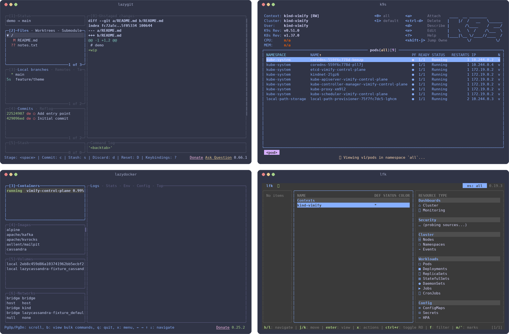
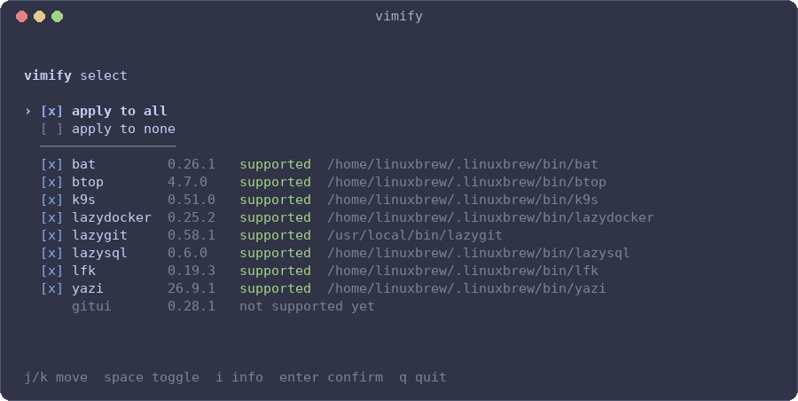
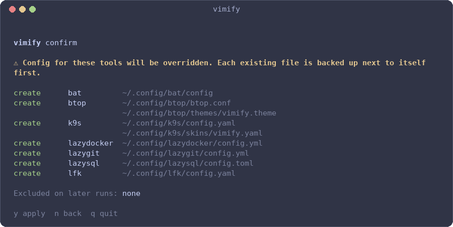

# vimify

> **Status:** under active development.

Same vim-style keybindings and same theme across your CLI and TUI tools,
configured from one file.



## What it does

- Detects the tools vimify supports on your machine.
- Lets you pick which ones to manage (all, or a manual selection).
- Writes only keybindings and theme into each tool's config. Your other settings
  are left alone.
- Backs up every file before changing it (`config.yaml` → `config.yaml.bak`).
- Remembers your selection, so excluded tools stay excluded when you rerun it.

## Install

```sh
brew install ike-forge/tap/vimify
```

Or the shell installer from the latest release. Planned: apt and other package
managers.

## Usage

```sh
vimify            # scan, select tools, apply
```



From the tool list you can install or revert vimify's config per tool, or for
all supported tools at once (recommended).



> **Warning:** applying vimify overrides keybinding and theme settings in the
> selected tools' configs. Backups are created, but review the list before
> confirming.

## Configuration

One reference config drives every tool:

`~/.config/vimify/config.toml`:

```toml
theme = "catppuccin-frappe"

[keys]
left = "h"
down = "j"
up = "k"
right = "l"
yank = "y"
delete = "d"
quit = "q"

[scan]
extra_paths = ["~/tools/bin"]
```

Commit it to your dotfiles. Committing the generated tool configs is only useful
if you also edit them outside vimify.

## Supported tools

bat, btop, k9s, lazydocker, lazygit, lazysql, lfk, stu and yazi. Coverage varies with
what each tool lets you configure: see [support.md](support.md).

See [vision.md](vision.md) for the longer-term direction.

## Development

Requires [mise](https://mise.jdx.dev).

```sh
mise install
mise run run
```

See [stack.md](stack.md) for the full task list.

`mise run screenshots` regenerates `docs/img` from the real tools under a throwaway
`HOME`. It needs tmux, Pillow and the sandbox kind cluster.

## Releasing

Run the *Prepare release* workflow with a version. It tags `master` once CI is
green, and the release workflow builds the archives and updates the Homebrew
formula in `ike-forge/homebrew-tap`. That last step needs a `HOMEBREW_TAP_TOKEN`
secret with push access to the tap.
